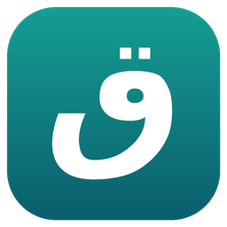
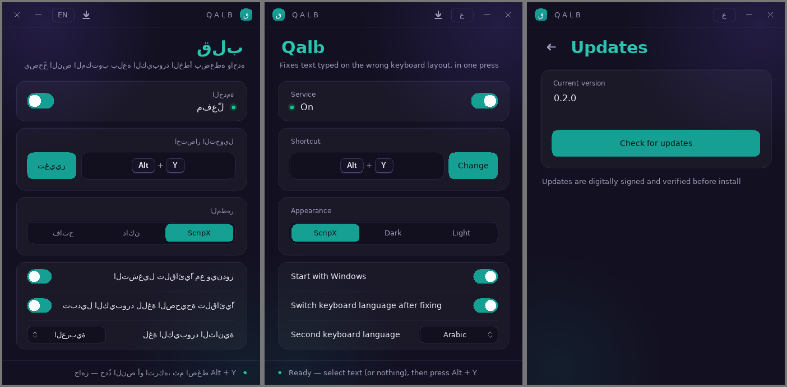

# قلب · Qalb

**كتبت وأنت ناسي لغة الكيبورد؟ اضغط اختصار واحد ويتصحّح النص.**
**Typed with the wrong keyboard language? One shortcut fixes it.**

`hkh hpf;` ← <kbd>Alt</kbd> + <kbd>Y</kbd> ← **انا احبك**

 

## [⬇️ تحميل قلب لويندوز](https://github.com/AzooozeM/qalb/releases/latest/download/Qalb.exe)

### [⬇️ Download Qalb for Windows](https://github.com/AzooozeM/qalb/releases/latest/download/Qalb.exe)

ملف واحد (أقل من 1MB) · بدون تثبيت · مجاني
One file (under 1 MB) · No install · Free

 

---

## طريقة الاستخدام

1. **حمّل** الملف `Qalb.exe` من الزر فوق.
2. **شغّله**. تظهر أيقونته جنب الساعة.
3. **إذا كتبت بلغة غلط**: حدّد النص (أو لا تحدد شيئًا لتصحيح السطر كله) واضغط <kbd>Alt</kbd> + <kbd>Y</kbd>.

وبس. يصحّح النص، ويحوّل لغة الكيبورد للغة الصحيحة عشان تكمل كتابة.

## إذا ظهر لك تحذير من ويندوز

البرنامج جديد وغير موقّع بشهادة تجارية بعد، فويندوز ممكن يعرض «Windows protected your PC»:
اضغط **More info** ← **Run anyway**.

بعض برامج الحماية تشك في أي برنامج يستخدم الاختصارات والحافظة. قلب لا يرسل أي بيانات، ولا يتصل بالإنترنت إلا إذا ضغطت «تحقق من التحديثات».

## المميزات

- **يشتغل في كل البرامج**: المتصفح، الواتساب، الوورد، ديسكورد...
- **الاتجاهين تلقائيًا**: إنجليزي ← عربي، وعربي ← إنجليزي، بنفس الاختصار.
- **ذكي مع النص المختلط**: يصحّح الجزء الغلط فقط.
- **كل لغات الكيبورد**: العربية مدمجة، و37 لغة ثانية بحزم صغيرة اختيارية.
- **آمن مع الألعاب**: يتوقف تلقائيًا داخل الألعاب اللي فيها أنظمة مكافحة غش، فما يعرّض حسابك للحظر.
- **خفيف جدًا**: ما يستهلك المعالج وهو ينتظر.
- **ثلاث ثيمات** (ScripX، داكن، فاتح)، والواجهة بالعربي والإنجليزي.
- **يتحدّث بضغطة**: من زر ↓ في البرنامج. كل تحديث موقّع رقميًا ويُتحقق منه قبل التثبيت.

## الخصوصية

لا يسجّل ما تكتب، ولا يحفظ النص، ولا يرسل أي شيء لأي مكان.

---

## How to use (English)

1. **Download** `Qalb.exe` from the button above.
2. **Run it.** Its icon appears next to the clock.
3. **Typed in the wrong language?** Select the text (or nothing, to fix the whole line) and press <kbd>Alt</kbd> + <kbd>Y</kbd>.

If Windows shows "Windows protected your PC", click **More info → Run anyway** (the app isn't commercially code-signed yet).

Qalb never logs your typing and only goes online when you press "Check for updates". Updates are signed and verified before they install. It pauses itself inside games that use anti-cheat, so it can't put your account at risk.

---

مشكلة أو اقتراح؟ [افتح بلاغ](https://github.com/AzooozeM/qalb/issues) · Found a problem? [Open an issue](https://github.com/AzooozeM/qalb/issues)

